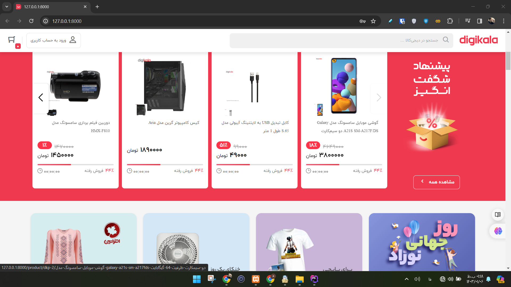

# Laravel Multi-Vendor Marketplace

[](https://github.com/AlirezaBelal/laravel-marketplace-demo/actions/workflows/ci.yml)
[](https://github.com/AlirezaBelal/laravel-marketplace-demo/actions/workflows/security-audit.yml)
[](https://github.com/AlirezaBelal/laravel-marketplace-demo/actions/workflows/database-compatibility.yml)

A modernized Laravel 13 / Livewire 4 multi-vendor marketplace codebase implementing customer, seller and administrator workflows, products, shopping carts, orders, payment records and notification integrations.

**Portfolio modernization candidate — not production-ready.** The supported dependency migration and automated checks are complete on the modernization branch, but browser and payment acceptance work remains. Do not deploy it with real customer data or credentials. GitHub's native archive banner, if present, is the authoritative read-only status.

This project is independent of and **not affiliated with, endorsed by, or operated by Digikala**.



## Implemented workflows

- Customers: registration, authentication, profiles, addresses, wishlists, product browsing, comparisons, comments, carts, shipping and orders.
- Sellers: registration and seller-facing marketplace routes.
- Administrators: product and commerce management components, payment records and dashboard views.
- Integrations: configurable payment drivers, SMS/email notifications, charts, SEO helpers, file management and Persian/Jalali dates.

These are implemented code paths, not claims of comprehensive acceptance testing, deployed customers or commercial operation.

## Stack and boundaries

PHP 8.4, Laravel 13.38, Livewire 4.4, Jetstream 5.5, Sanctum 4.3, Blade, Eloquent, MySQL 8.4, Vite 8 and Tailwind 4, alongside retained Bootstrap and other UI assets. Payment integration uses Shetabit Multipay; SMS integration uses Kavenegar.

Routes, controllers and Livewire components coordinate Eloquent models and external adapters. Payment callbacks call the configured gateway's verification API with the recorded transaction and amount before changing payment/order state. Those database updates run in a transaction; SMS/email delivery follows the commit.

This is a code-level review of the callback, not proof of complete payment correctness, authorization coverage, concurrency safety or certification against a live gateway. No live payment or notification delivery is claimed.

## Local inspection and setup

Use an isolated local environment with synthetic records only. Do not expose this application publicly or supply production credentials.

Requirements for **isolated local testing**: PHP 8.4, Composer 2, Node.js 22, npm and MySQL 8.4. Use test-only credentials and avoid importing historical SQL backups.

```bash
git clone https://github.com/AlirezaBelal/laravel-marketplace-demo.git
cd laravel-marketplace-demo
cp .env.example .env
composer install
php artisan key:generate
npm ci
npm run build
```

Configure a **new, disposable** main database in `.env` and provision the five additional category databases defined in `config/database.php` before running migrations. The GitHub Actions database workflow provisions all six schemas automatically with synthetic credentials. On an empty test database only:

```bash
php artisan migrate
php artisan serve --host=127.0.0.1
```

The checked-in environment defaults to the local payment driver and disabled debug mode. Keep payment, SMS, mail and database credentials outside Git. **Never use `migrate:fresh` on an existing database**: it drops tables. No comprehensive demo catalog or end-to-end installation/data fixture is claimed. See [the acceptance checklist](ACCEPTANCE_TESTING.md).

## Security and verification status

The original Laravel 9 dependency graph was vulnerable. The modernization branch regenerated both lockfiles, removed the former Composer audit ignore list, and replaced the obsolete Mix/webpack build. All three workflow groups have passed together:

- **CI:** repository safety, framework checks, selected regression tests and Vite build.
- **Dependency security audit:** `composer audit --locked` and the full `npm audit --audit-level=low`, including development packages.
- **Database migration and feature compatibility:** 106 active migrations on six disposable MySQL 8.4 schemas, a second no-op migration pass, and **62 Feature tests with 93 assertions**. Eighteen tests are explicitly skipped for disabled or conditionally unavailable features, not silently omitted. Chrome Headless also renders four public entry points.

These results were verified in [GitHub Actions](https://github.com/AlirezaBelal/laravel-marketplace-demo/actions) on the modernization branch. Historical duplicate migrations (74 files) are preserved at `database/migrations/legacy-snapshots/`. Some obsolete Bootstrap/Popper notices remain even though the full dependency security audits pass. **Green audits do not prove application-level payment correctness, complete authorization, browser compatibility or production readiness.** See [MODERNIZATION.md](MODERNIZATION.md) and [SECURITY.md](SECURITY.md).

## Preservation and public-content review

On 2026-10-25, the owner rewrote both repository branches to remove historical SQL backups and replace Google API key patterns. This does not establish deletion of old pull-request references, cached objects, forks or existing clones. A GitHub Support request has been filed, but server-side cleanup remains pending. The owner reports cancelling Google Cloud; this has not independently established that historically exposed keys are revoked or unusable. Never restore old dumps or merge pre-cleanup history. See [cleanup notes](SECURITY_REMEDIATION.md).

The owner approved retention of the existing imagery, fonts and UI assets for this portfolio artifact. They remain unchanged. This records the owner's decision, not an independent legal clearance; Apache-2.0 does not grant rights over third-party material.

The owner authorized modernization while preserving the repository identity and project assets. Final merge/archive acceptance remains pending the browser, payment and security limitations documented above. No security audit is disabled or weakened for archival.

## License

Project-authored code is distributed under the existing [Apache License 2.0](LICENSE). Third-party packages, fonts, images, trademarks and other assets remain subject to their own rights and terms.
